# STM32F405 Dart Flight Controller - Stage 1.1 Software Architecture Review

> Scope: architecture design only. This document does not implement BMI088, Servo, UART protocol, PID, attitude estimation, XTailMixer, FlightController, or any runtime logic.
>
> Source of truth for hardware facts: current `../A133P_Dart.ioc` and regenerated `../Core/`.
>
> Stage 0 audit is a historical baseline. Current `.ioc` and generated code have changed after Stage 0.
>
> Stage 1.1 keeps the Stage 1 architecture and resolves interface, dependency, ownership, timebase, and unit consistency issues. It creates no source code.

## 1. Design Goals

The goal of Stage 1/1.1 is to define the software shape before writing user business code:

- Keep CubeMX-generated `Core/` code isolated and regeneratable.
- Put all user-owned C++ code under `User/`.
- Separate MCU peripheral drivers, real devices, pure algorithms, system orchestration, and task/ISR bridging.
- Make HAL dependency flow one way: low-level user drivers may wrap HAL, higher layers must not include or call HAL directly.
- Preserve hard real-time boundaries: ISR updates pending flags/counters, millisecond timestamps, and small metadata only; task/application context performs device reads, parsing, algorithms, and actuator updates.
- Give every exchanged data object explicit semantics, units, and coordinate assumptions.
- Allow staged bring-up: C++ link test first, then Common/Config, drivers, devices, algorithms, application, and full skeleton.

## 2. Design Constraints

### Current hardware facts

| Item | Current fact | Source |
|---|---|---|
| MCU | `STM32F405RGT6`, CubeMX name `STM32F405RGTx`, LQFP64 | `../A133P_Dart.ioc:31,43,44` |
| HCLK | 168 MHz | `../A133P_Dart.ioc:169` |
| APB1 timer clock | 84 MHz | `../A133P_Dart.ioc:161` |
| APB2 timer clock | 168 MHz | `../A133P_Dart.ioc:164` |
| SPI1 | PA5 SCK, PA6 MISO, PA7 MOSI, CPOL HIGH, CPHA 2EDGE, prescaler 16, 5.25 Mbit/s | `../A133P_Dart.ioc:108-113,201-208`, `../Core/Src/spi.c` |
| BMI088 CS | PA2 ACC CS, PA3 GYRO CS, initial HIGH | `../A133P_Dart.ioc:94-103`, `../Core/Src/gpio.c:53` |
| BMI088 DRDY | PA4 `Data_Ready_INT`, EXTI4 enabled | `../A133P_Dart.ioc:104-107`, `../A133P_Dart.ioc:76`, `../Core/Src/stm32f4xx_it.c:207` |
| Heater PWM | TIM3 CH3 on PB0 | `../A133P_Dart.ioc:116,220-221` |
| Servo PWM | TIM1 CH1-CH4 on PA8, PA9, PA10, PA11 | `../A133P_Dart.ioc:114-115,88-89,209-219` |
| USART1 | PB6 TX, PB7 RX, DMA2 Stream2 RX, DMA2 Stream7 TX | `../A133P_Dart.ioc:117-120,5-27` |
| TIM5 | PSC=167, ARR=499, intended 1 kHz heartbeat | `../A133P_Dart.ioc:222-224`, `../Core/Src/tim.c:182-184` |

### Current generated-code state

`main()` calls `HAL_Init`, `SystemClock_Config`, `MX_GPIO_Init`, `MX_DMA_Init`, `MX_USART1_UART_Init`, `MX_SPI1_Init`, `MX_TIM1_Init`, `MX_TIM3_Init`, and `MX_TIM5_Init`, then enters an empty `while(1)` (`../Core/Src/main.c:78-110`). TIM1/TIM3/TIM5/UART DMA are initialized but not started by user code yet.

Current TIM1 settings are `PSC=167`, `ARR=19999`, `Pulse=1500` (`../Core/Src/tim.c:48-50,74`). With APB2 timer clock 168 MHz:

```text
timer tick = 168 MHz / (167 + 1) = 1 MHz
PWM frequency = 1 MHz / (19999 + 1) = 50 Hz
```

This gives the desired 1 us counter resolution, but not the desired 333 Hz digital-servo refresh. Stage 1.1 must not change `.ioc`; a later hardware-configuration stage should adjust TIM1 to about `ARR=3002` for 333 Hz if that target is approved.

Current TIM5 settings are `PSC=167`, `ARR=499` (`../Core/Src/tim.c:182-184`). With APB1 timer clock 84 MHz:

```text
timer tick = 84 MHz / (167 + 1) = 500 kHz
interrupt frequency if started = 500 kHz / (499 + 1) = 1 kHz
```

TIM5 therefore provides a 1 ms scheduler heartbeat in the first implementation. It does not provide a true microsecond timestamp. Stage 2 uses `uint32_t` millisecond timestamps and `Class_Timebase::NowMs()`. A future microsecond timebase requires DWT or another high-resolution timer and is explicitly deferred.

### C++ constraints

- User layer uses C++ conservatively: `class`, `struct`, `enum class`, composition, pointer/reference dependency injection where useful.
- No `namespace`.
- No `new` / `delete`.
- No dynamic allocation dependency.
- Avoid complex STL.
- No exceptions and no RTTI in intended design.
- Core objects are statically allocated and initialized after HAL peripherals are ready.
- CubeMX/HAL code remains C.
- Stage 2 should start with the smallest possible C++ compile/link bring-up.

## 3. Final Layered Architecture

The project should use the following layers:

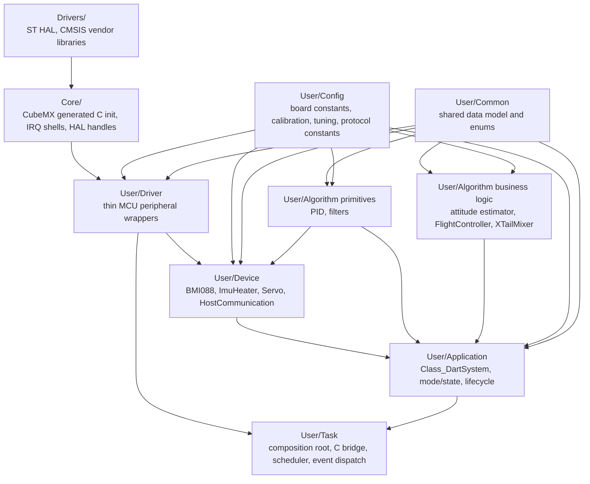

Practical rule: lower hardware layers provide services upward; upper layers do not reach down around their dependency.

## 4. Directory / File Layout

This is a target layout for Stage 2 and later. Stage 1.1 creates none of these source files.

```text
Core/
  Inc/
  Src/
Drivers/
  CMSIS/
  STM32F4xx_HAL_Driver/
User/
  Config/
    board_hardware_config.h
    servo_config.h
    control_config.h
    safety_config.h
    protocol_config.h
    heater_config.h
  Common/
    common_types.h
    coordinate_convention.h
    imu_data.h
    attitude_state.h
    control_command.h
    surface_command.h
    system_status.h
  Driver/
    class_gpio_pin.h
    class_gpio_pin.cpp
    class_spi_bus.h
    class_spi_bus.cpp
    class_pwm_channel.h
    class_pwm_channel.cpp
    class_uart_dma.h
    class_uart_dma.cpp
    class_timebase.h
    class_timebase.cpp
  Device/
    class_bmi088.h
    class_bmi088.cpp
    class_imu_heater.h
    class_imu_heater.cpp
    class_servo.h
    class_servo.cpp
    class_host_communication.h
    class_host_communication.cpp
  Algorithm/
    class_pid.h
    class_pid.cpp
    class_filter.h
    class_filter.cpp
    class_attitude_estimator.h
    class_attitude_estimator.cpp
    class_flight_controller.h
    class_flight_controller.cpp
    class_xtail_mixer.h
    class_xtail_mixer.cpp
  Application/
    class_dart_system.h
    class_dart_system.cpp
  Task/
    task_bridge.h
    task_bridge.cpp
    task_scheduler.h
    task_scheduler.cpp
```

Recommended Stage 2 sequencing should not create all files at once. Add files only as needed for a compiling skeleton. `host_command.h` and `host_frame_parser.h/.cpp` are added only by the formal Protocol Stage after command types, payloads, and units are defined. The first Stage 2 event model uses translation-unit-static pending flags, counters, and small metadata in `task_bridge.cpp`/`task_scheduler.cpp`; it does not include an event queue.

## 5. Dependency Rules

Allowed include directions:

```text
User/Config     -> no User dependency, may include fixed-width C types
User/Common     -> no Driver/Device/Algorithm/Application dependency
User/Driver     -> Config, Common, Core HAL headers
User/Device     -> Config, Common, Driver, and pure general Algorithm primitives only
User/Algorithm  -> Config, Common only; primitives remain independent of Device/business logic
User/Application-> Config, Common, Device, Algorithm; Driver reference types only for construction/binding
User/Task       -> Config, Common, Driver, Application, C bridge headers, Core handles if required
Core            -> generated code only; should only call tiny extern "C" bridge functions
```

The Device-to-Algorithm allowance is a strict allowlist for stateless/stateful general math primitives such as `Class_Pid` and `Class_Filter`. It does not grant Device a dependency on the Algorithm layer as a whole. Application may pass Driver references into owned Device objects during composition, but its lifecycle/control logic must not call Driver operations directly.

Forbidden dependencies:

| From | Must not include/call | Reason |
|---|---|---|
| `Algorithm/` | HAL, `main.h`, `tim.h`, `spi.h`, `usart.h` | Algorithms must be unit-testable without STM32 hardware. |
| `Device/` | `FlightController`, `XTailMixer`, or other business algorithms | Devices may reuse only pure general primitives such as PID/filter; they must not depend on flight-control policy or allocation. |
| `Application/` business logic | HAL or direct Driver operations | Task binds infrastructure; Device objects consume injected Driver services. |
| `FlightController` | Servo, PWM, TIM, UART, BMI088 SPI | It consumes semantic state and commands only. |
| `XTailMixer` | Servo, PWM, TIM, pins, pulse widths | It maps body control command to logical surface deflection only. |
| `Servo` | FlightController, XTailMixer, UART, BMI088 | It only maps logical deflection to one physical PWM channel. |
| `Driver/` | BMI088, Servo1, A133P, XTail | Drivers wrap MCU peripherals, not products/devices. |
| `Core/` | C++ internals | Keep CubeMX regeneration simple. |

Dependency direction:

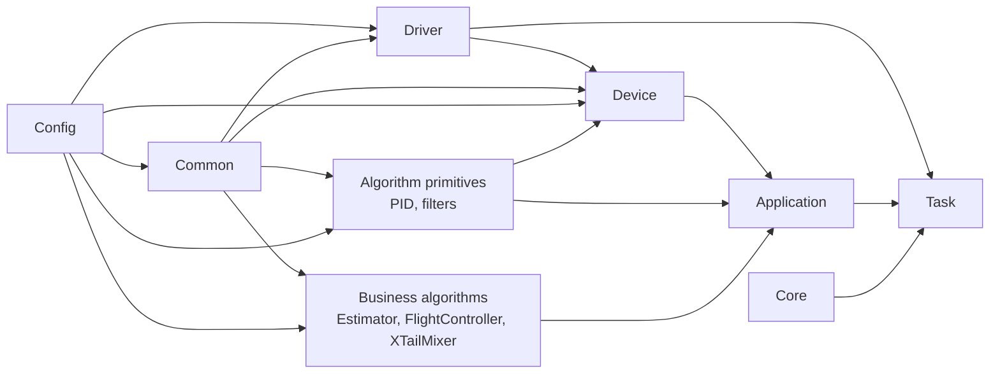

## 6. Common Data Model

All common data structures must state units and coordinate convention. Section 21 defines the architecture-baseline body convention. The BMI088 sensor-frame-to-body-frame transform still requires hardware confirmation.

### Core enums

```cpp
enum class ResultCode {
    Ok,
    NotReady,
    Timeout,
    InvalidData,
    HardwareError,
    ConfigError
};

enum class FlightMode {
    Init,
    Ready,
    Active,
    Failsafe
};

enum class SurfaceId {
    Servo1RightUpper,
    Servo2LeftUpper,
    Servo3LeftLower,
    Servo4RightLower
};

enum class FaultCode : uint32_t {
    None = 0,
    ImuInit = 1u << 0,
    ImuStale = 1u << 1,
    HostTimeout = 1u << 2,
    InvalidHostData = 1u << 3,
    ControllerInvalid = 1u << 4,
    TaskOverrun = 1u << 5
};

using FaultFlags = uint32_t;
```

`FaultCode` values are bit positions. `FaultFlags` stores the active set; bitwise helper functions should be provided rather than scattering casts. Additional fault bits may be added without changing the active-fault model.

### `ImuData`

| Field | Type | Meaning | Unit | Coordinate |
|---|---|---|---|---|
| `specific_force_x_mps2` | `float` | Body-X accelerometer measurement (specific force) | m/s^2 | body frame after confirmed sensor-to-body transform |
| `specific_force_y_mps2` | `float` | Body-Y accelerometer measurement (specific force) | m/s^2 | body frame after confirmed sensor-to-body transform |
| `specific_force_z_mps2` | `float` | Body-Z accelerometer measurement (specific force) | m/s^2 | body frame after confirmed sensor-to-body transform |
| `gyro_x_radps` | `float` | Angular rate around body X | rad/s | positive roll convention |
| `gyro_y_radps` | `float` | Angular rate around body Y | rad/s | positive pitch convention |
| `gyro_z_radps` | `float` | Angular rate around body Z | rad/s | positive yaw convention |
| `temperature_deg_c` | `float` | BMI088 measured temperature | deg C | sensor local |
| `sample_timestamp_ms` | `uint32_t` | Sample timestamp | ms | system monotonic time |
| `data_ready_seq` | `uint32_t` | DRDY event sequence when event-driven | count | system |
| `valid` | `bool` | Data sanity result | boolean | N/A |

The accelerometer fields are BMI088 measurements expressed as specific force after calibration and axis transformation. They include gravity/apparent-acceleration effects according to accelerometer physics; they are not direct translational linear acceleration and must not be interpreted directly as normal load or overload.

### `AttitudeState`

| Field | Type | Meaning | Unit | Coordinate |
|---|---|---|---|---|
| `roll_rad` | `float` | Rotation around body X | rad | body convention |
| `pitch_rad` | `float` | Rotation around body Y | rad | body convention |
| `yaw_rad` | `float` | Rotation around body Z or heading estimate | rad | body/navigation convention |
| `roll_rate_radps` | `float` | Roll rate | rad/s | body convention |
| `pitch_rate_radps` | `float` | Pitch rate | rad/s | body convention |
| `yaw_rate_radps` | `float` | Yaw rate | rad/s | body convention |
| `timestamp_ms` | `uint32_t` | Estimate timestamp | ms | system monotonic time |
| `valid` | `bool` | Estimator output sanity | boolean | N/A |

Quaternion can be added later if the estimator needs it. Do not force quaternion into every interface before the first estimator exists.

### A133P `GuidanceCommand` / `HostCommand` - DEFERRED

Stage 1.1 does not define `HostCommandType`, command variants, or a float-based guidance payload. In particular, `Arm`, `Disarm`, `Guidance`, and `Heartbeat` are not locked protocol command types. The formal Protocol Stage must define frame format, message types, payload fields, validity rules, sequence behavior, coordinate frames, and an explicit unit for every numeric field before a semantic `HostCommand` or `GuidanceCommand` is added to Common.

Stage 2 may retain transport-only RX metadata such as byte count and `uint32_t receive_timestamp_ms`; that metadata is not a semantic host command. Any future semantic command timestamp also uses the `uint32_t timestamp_ms` monotonic millisecond convention unless a later high-resolution timebase decision replaces it explicitly.

### `BodyControlCommand`

| Field | Type | Meaning | Unit | Coordinate |
|---|---|---|---|---|
| `roll_equiv_rad` | `float` | Equivalent roll surface-control request | rad | body convention |
| `pitch_equiv_rad` | `float` | Equivalent pitch surface-control request | rad | body convention |
| `yaw_equiv_rad` | `float` | Equivalent yaw surface-control request | rad | body convention |
| `timestamp_ms` | `uint32_t` | Command generation time | ms | system monotonic time |
| `valid` | `bool` | Controller output sanity | boolean | N/A |

These are equivalent angular deflection requests used by the control allocator, not body attitude angles. The internal unit is locked to radians; limits and saturation are explicit configuration in radians.

### `SurfaceCommand`

| Field | Type | Meaning | Unit | Coordinate |
|---|---|---|---|---|
| `surface_deflection_rad[4]` | `float[4]` | Logical Servo1-4 requested surface deflection | rad | per-surface positive convention |
| `timestamp_ms` | `uint32_t` | Mixer output time | ms | system monotonic time |
| `valid` | `bool` | Mixer output sanity | boolean | N/A |

`Class_Servo` is the only layer that converts the requested surface deflection from radians to pulse width in microseconds and then to the PWM driver's compare representation. No normalized-or-angle runtime ambiguity is permitted in this interface.

### `SystemStatus`

| Field | Type | Meaning | Unit |
|---|---|---|---|
| `mode` | `FlightMode` | Current high-level system mode | enum |
| `imu_ready` | `bool` | BMI088 initialized and data sane | boolean |
| `heater_ready` | `bool` | Heater controller initialized | boolean |
| `host_alive` | `bool` | Protocol-defined host liveness condition is fresh, if required | boolean |
| `servo_ready` | `bool` | PWM outputs configured and safe | boolean |
| `fault_flags` | `FaultFlags` | Bitmask of all currently active faults | bitmask |
| `last_error` | `ResultCode` | Most recent system-level error | enum |
| `uptime_ms` | `uint32_t` | Monotonic system uptime | ms |
| `overrun_count` | `uint32_t` | Scheduler/task overrun count | count |

## 7. Class Responsibility Table

| Class | Responsibility | Owns | Depends On | Public Interface examples | Must NOT Do |
|---|---|---|---|---|---|
| `Class_GpioPin` | Wrap one GPIO pin operations | pin config reference only | HAL GPIO port/pin | `SetHigh()`, `SetLow()`, `Read()` | Know BMI088 or servo semantics |
| `Class_SpiBus` | Wrap SPI transfer on one HAL SPI handle | SPI handle reference | `SPI_HandleTypeDef*` | `Transfer(tx, rx, len, timeout)` | Toggle BMI088 CS by itself unless explicitly passed a transaction guard |
| `Class_PwmChannel` | Provide generic timer PWM output | TIM handle, channel id, timer tick/period metadata | `TIM_HandleTypeDef*` | `Start()`, `Stop()`, `SetCompareTicks(uint32_t)`, `SetDutyCycle(float duty_0_to_1)`; optional `SetPulseWidthUs(uint32_t)` helper | Assume PWM is a servo, or apply servo reverse/trim/angle/limit logic |
| `Class_UartDma` | Wrap USART DMA RX/TX events | UART handle, buffers | `UART_HandleTypeDef*`, DMA via HAL | `StartReceiveToIdle()`, `SendAsync()`, `OnRxEvent()` | Parse host command semantics |
| `Class_Timebase` | Provide first-version monotonic millisecond time | 1 kHz tick counter | TIM5/SysTick bridge | `NowMs()`, `OnTickIsr()` | Claim microsecond resolution or run algorithms |
| `Class_Bmi088` | BMI088 sensor device | CS pins, SPI dependency, sensor status | `Class_SpiBus`, `Class_GpioPin` | `Init()`, `ReadSample()`, `OnDataReady()` | Control heater PWM/PID |
| `Class_ImuHeater` | BMI088 temperature-control actuator | heater state, PID member or dependency | `Class_PwmChannel`, `Class_Pid` pure primitive, temperature input | `Init()`, `Update(temp_deg_c, dt_s)`, `SetTargetDegC()` | Read BMI088 registers or depend on business algorithms |
| `Class_Servo` | One logical servo actuator; convert surface deflection radians to pulse width | config for logical surface, PWM channel dependency | `Class_PwmChannel`, `ServoConfig` | `SetNeutral()`, `SetDeflectionRad()`, `Disable()` | Compute X-tail allocation, run controller, or expose pulse width as the Common surface-command unit |
| `Class_HostCommunication` | Manage UART transport and the future protocol boundary | RX state; future parser helper | `Class_UartDma`; `HostFrameParser` only after Protocol Stage | `Init()`, `Poll()`; semantic command access deferred | Invent host command types/units before the Protocol Stage or know flight-control internals |
| `HostFrameParser` | Pure frame parsing and validation once the protocol is defined | parser state | protocol config | `Feed(bytes)`; parsed output type deferred | Call HAL, update system state, or invent a placeholder float payload |
| `Class_Pid` | Generic PID math | gains, integrator, limits | config only | `Reset()`, `Update(error, dt_s)` | Know sensors, servos, flight-control policy, or HAL |
| `Class_AttitudeEstimator` | Estimate attitude from IMU | estimator state | `ImuData`, config | `Reset()`, `Update(imu, dt_s)` | Read SPI directly |
| `Class_FlightController` | Generate body R/P/Y equivalent commands in radians | controller state, PID members | protocol-defined semantic input (deferred), `ImuData`, `AttitudeState` | `Reset()`, `Update(inputs)` | Call mixer, servo, HAL, or UART |
| `Class_XTailMixer` | Allocate body R/P/Y command to four logical surfaces | mixer matrix/config | `BodyControlCommand` | `Mix(body_cmd)` | Convert angle to PWM pulse |
| `Class_TaskScheduler` | Dispatch due tasks from flags/ticks | task flags/counters | `Class_DartSystem` | `OnTickIsr()`, `RunPending()` | Perform blocking work inside ISR |
| `Class_DartSystem` | Coordinate the full business lifecycle | devices, algorithms, system state | injected device/algorithm dependencies and config references | `Init()`, `RunOnce()`, `OnTick()`, `OnImuDataReady()` | Own HAL handles/driver wrappers or become a dump for driver/algorithm internals |

## 8. Object Ownership Tree

`User/Task/task_bridge.cpp` is the composition root. It holds driver wrappers and the single top-level business object as translation-unit-static objects; none are exposed as scattered `extern` globals. Peripheral wrappers bind pointers/references to CubeMX-owned HAL handles during `Task_Init()` after generated peripheral initialization.

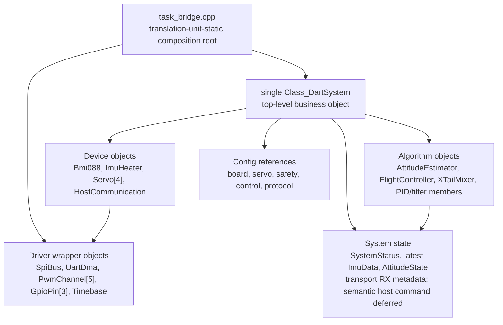

Ownership guidelines:

| Object type | Own by value? | Why |
|---|---:|---|
| `Class_DartSystem` | translation-unit-static in `task_bridge.cpp` | Preserves one top-level business object without exporting a global symbol. |
| HAL handles | no, external C globals | Generated by CubeMX; wrappers bind after MX init. |
| Driver wrappers | translation-unit-static in `task_bridge.cpp` | Infrastructure is constructed/bound by the composition root and injected; it is not business ownership of `Class_DartSystem`. |
| Device objects | value members in `Class_DartSystem` | Device lifetime equals system lifetime. |
| Algorithm objects | value members in `Class_DartSystem` | Pure stateful math, deterministic lifetime. |
| Config tables | `const` static data or references | Board/tuning data should be immutable unless explicitly tunable. |
| Pending flags/counters/metadata | translation-unit-static in Task | Sufficient for TIM5, BMI088 DRDY, and UART RX in Stage 2; avoid scattered `extern` flags. |

`Task_Init()` binds HAL handles into the driver wrappers, constructs or initializes the dependency graph, injects driver references into devices through `Class_DartSystem`, and then starts hardware in the safe order. Driver objects are not `Class_DartSystem` value members.

## 9. Initialization Sequence

Target startup sequence:

```text
Reset
 -> startup_stm32f405xx.s
 -> main()
 -> HAL_Init()
 -> SystemClock_Config()
 -> MX_GPIO_Init()
      - BMI088 ACC/GYRO CS already HIGH after generated GPIO init
      - EXTI4 line configured, but user event handling not active yet
 -> MX_DMA_Init()
 -> MX_USART1_UART_Init()
 -> MX_SPI1_Init()
 -> MX_TIM1_Init()
      - CCR initial value generated as 1500 us at current 1 us timer tick
 -> MX_TIM3_Init()
 -> MX_TIM5_Init()
 -> Task_Init()
      - bind HAL handles to translation-unit-static C++ driver wrappers
      - inject driver dependencies into the single Class_DartSystem business object
      - verify config consistency
      - start TIM1 PWM channels only after neutral CCR is written/confirmed
      - command all logical servos to neutral
      - start TIM3 heater PWM at 0 duty or configured safe duty
      - initialize BMI088 device; CS must remain HIGH except active transaction
      - initialize host communication and start UART DMA RX strategy
      - reset estimator/controller/mixer state
      - clear stale EXTI/UART/TIM flags
      - start TIM5 base interrupt only after system objects can receive ticks
 -> set mode READY if mandatory readiness checks pass
 -> while(1)
      - Task_Loop()
```

Important ordering decisions:

| Question | Stage 1.1 decision |
|---|---|
| When to start servo PWM? | After `MX_TIM1_Init`, after C++ servo objects bind and write/confirm neutral, before `READY`. |
| What is safe servo output before active flight? | Neutral pulse = 1500 us + per-servo trim. |
| When to start TIM5? | Last, after `Class_DartSystem::Init()` can handle scheduler events. |
| When to start UART DMA RX? | During `HostCommunication::Init()`, after UART driver and RX buffers are bound. |
| What if PA4 EXTI fires before BMI088 ready? | ISR only records a pending flag/counter and `timestamp_ms`; application ignores or counts it until BMI088 status is ready. |
| When does FlightController output reach servo? | Only in `ACTIVE`; all other modes command neutral unless a later approved safety policy says otherwise. |

## 10. Runtime Scheduling

TIM5 should be the 1 kHz base heartbeat. It must not imply every algorithm runs at 1 kHz.

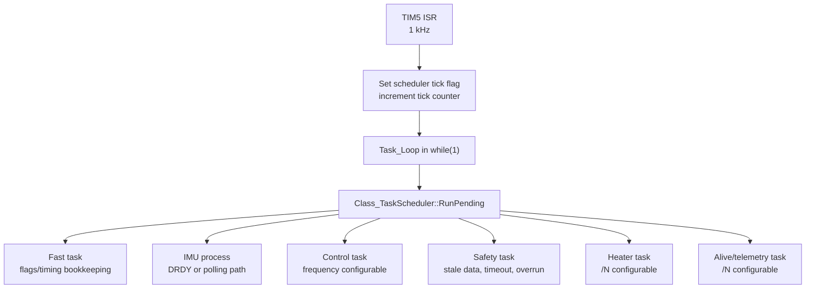

Initial scheduling model:

| Task | Trigger | Suggested Stage 1.1 status |
|---|---|---|
| Base tick | TIM5 1 kHz | locked as scheduler heartbeat concept |
| IMU event process | PA4 DRDY flag or polling divider | configurable; support both bring-up polling and formal DRDY |
| Control task | divided from base tick or data-ready event | deferred frequency |
| Safety task | base tick or fixed divider | required mechanism, exact period configurable |
| Heater task | fixed divider | deferred frequency |
| Host communication | UART RX event plus polling service | DMA+IDLE preferred later, protocol deferred |
| Telemetry/alive | fixed divider | deferred |

Overrun rule: if a scheduled task is still marked running when triggered again, increment `overrun_count`, record a safety event, and skip or degrade according to safety policy. Do not recursively run tasks.

Stage 2 uses simple pending flags/counters for TIM5 ticks, BMI088 DRDY, and UART RX events. These event classes do not require FIFO ordering in the first implementation. `isr_event_queue.h/.cpp` is excluded; an EventQueue is deferred until a real requirement exists to preserve multiple ordered event instances.

## 11. Interrupt/Event Model

ISR rules:

Allowed in ISR:

- Invoke HAL-required IRQ handler.
- Capture `uint32_t timestamp_ms` or the 1 kHz tick count.
- Increment counters.
- Set event flags.
- Copy very small event metadata such as byte count from HAL callback.

Forbidden in ISR:

- SPI bulk read.
- BMI088 register transaction.
- PID.
- Attitude estimator.
- X-tail mixer.
- Servo allocation calculation.
- UART frame parsing.
- `printf`.
- Blocking HAL calls.
- Large `memcpy`.

Event flow:

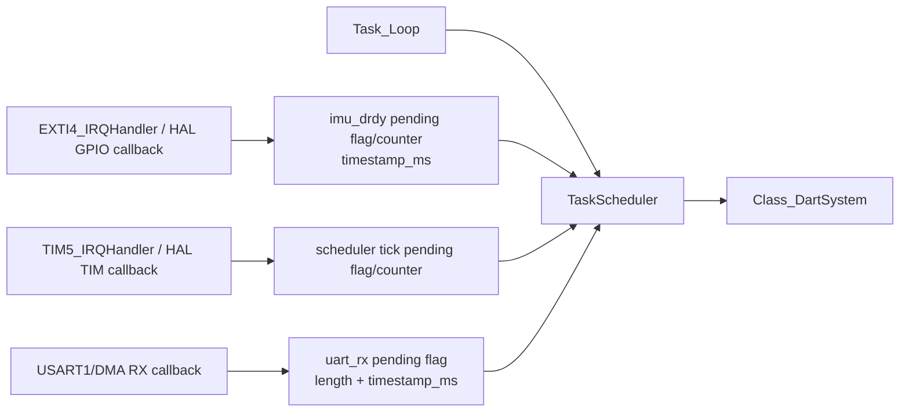

The C callback layer should expose small functions:

```cpp
extern "C" void Task_Init(void);
extern "C" void Task_Loop(void);
extern "C" void Task_OnTim5ElapsedIsr(void);
extern "C" void Task_OnImuDataReadyIsr(uint32_t timestamp_ms);
extern "C" void Task_OnUartRxEventIsr(uint16_t size, uint32_t timestamp_ms);
```

These are interface declarations for design only, not Stage 1.1 implementation. The timestamp arguments have 1 ms resolution in the first version. A signature carrying `_us` is forbidden until a real microsecond source is introduced.

## 12. IMU Data Flow

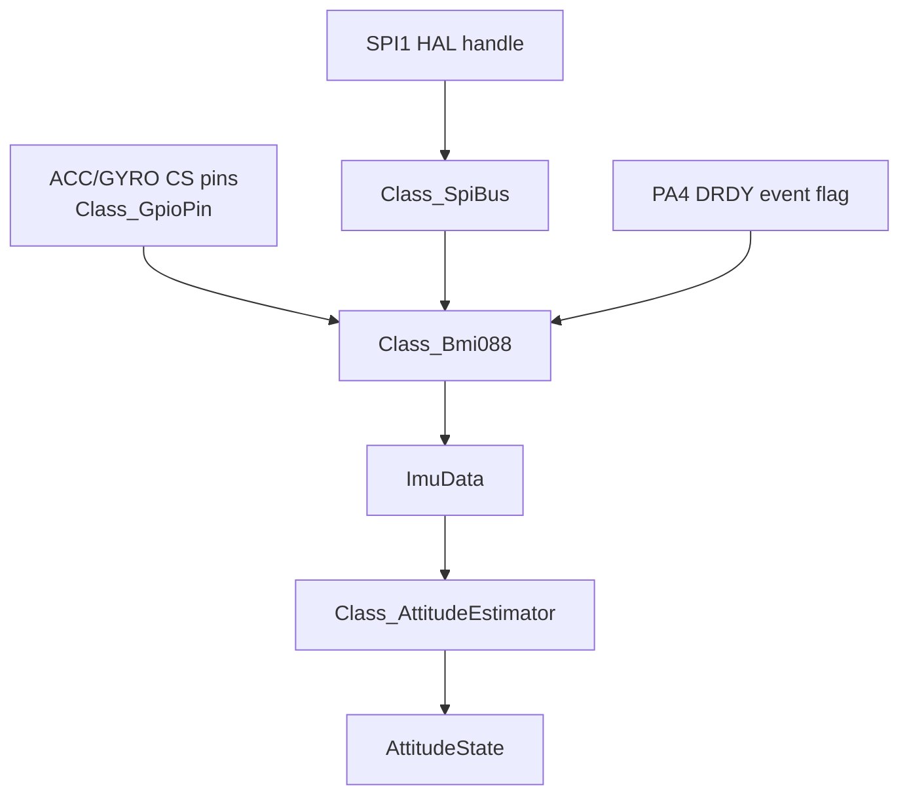

BMI088 architecture decisions:

- `Class_Bmi088` owns sensor state and uses SPI/CS dependencies.
- It may support bring-up polling, DRDY-driven sampling, or mixed mode.
- It publishes calibrated accelerometer measurement as specific force in m/s^2, never as presumed translational linear acceleration or normal load.
- It applies an explicit sensor-frame-to-body-frame transform from board/sensor config after that transform is confirmed on hardware.
- It should expose temperature as part of `ImuData`; heater control consumes temperature but is not part of the sensor driver.
- It must keep CS pins HIGH when idle and assert only the selected CS during a transaction.
- It should not run control algorithms or write servo outputs.

## 13. Host Command Data Flow

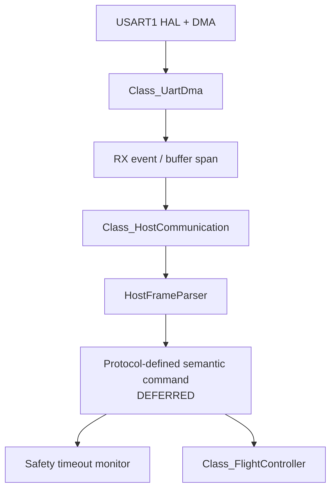

Boundary rules:

- `Class_UartDma` knows UART handle, DMA mode, RX/TX buffers, and receive events.
- `Class_HostCommunication` owns transport/framing at the protocol boundary. Its concrete semantic output type is deferred to the formal Protocol Stage.
- Once defined, `Class_FlightController` receives only validated semantic commands with explicit units; it must not know baudrate, DMA stream, frame header, CRC byte location, or packet length.
- DMA+IDLE is the preferred future receive strategy, but the final implementation remains deferred.
- Stage 2 must not invent `Arm`, `Disarm`, `Guidance`, or `Heartbeat` command variants to fill this deferred boundary.

## 14. Flight Control Data Flow

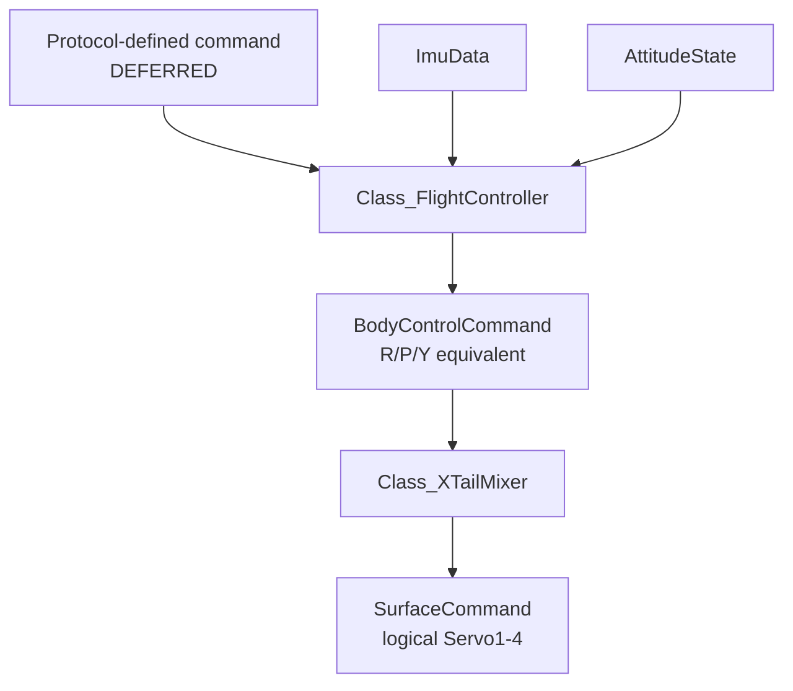

`Class_FlightController` answers: "What roll, pitch, yaw equivalent angular control action should the body receive?" Its output is `BodyControlCommand` in radians.

It should support a first simple controller and later cascade controller/feedforward without changing Device or Driver interfaces. The first design should not let a specific PID topology dominate the whole architecture.

## 15. X-Tail Control Allocation

Logical surface numbering, viewed from dart tail toward dart nose:

```text
                 UP
                  ^

        Servo2 \     / Servo1
                \   /
                 BODY
                /   \
        Servo3 /     \ Servo4
```

Logical mapping:

| Logical surface | Meaning |
|---|---|
| Servo1 | Right Upper |
| Servo2 | Left Upper |
| Servo3 | Left Lower |
| Servo4 | Right Lower |

Baseline allocation from current algorithm notes:

```text
M_roll  proportional to ( d1 - d2 - d3 + d4 )
M_pitch proportional to ( d1 + d2 - d3 - d4 )
M_yaw   proportional to ( d1 - d2 + d3 - d4 )

d1 = ( R + P + Y) / 2
d2 = (-R + P - Y) / 2
d3 = (-R - P + Y) / 2
d4 = ( R - P - Y) / 2
```

Where:

- `R` = `roll_equiv_rad`.
- `P` = `pitch_equiv_rad`.
- `Y` = `yaw_equiv_rad`.
- `d1..d4` = `surface_deflection_rad[0..3]` for logical Servo1..Servo4.

All six quantities in the allocation equations use radians. Mixer limits and coefficients must preserve that unit.

Architecture decision:

- The matrix belongs only in `Class_XTailMixer` or an equivalent `ControlAllocator`.
- It must not be copied into Servo, PWM driver, FlightController, Task, or Device code.
- Matrix signs require practical verification before flight use.
- If signs change after a physical test, only mixer/config should change.

## 16. Servo Abstraction and Config Mapping

Servo control chain:

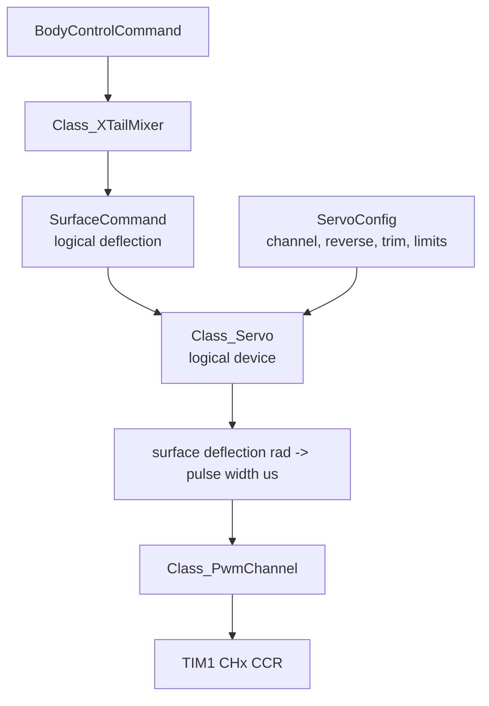

Critical rule: `Servo1..Servo4` are logical surfaces, not hard-coded aliases for TIM channels. Physical mapping belongs in `User/Config/servo_config.h`.

Recommended servo config fields:

| Field | Meaning | Unit |
|---|---|---|
| `surface_id` | Logical Servo1-4 identity | enum |
| `pwm_channel_id` | Physical TIM1 channel mapping | enum/integer |
| `reversed` | Mechanical/electrical direction inversion | boolean |
| `neutral_pulse_us` | Neutral command before trim | us |
| `trim_pulse_us` | Per-servo neutral correction | us |
| `physical_min_pulse_us` | Absolute physical lower pulse | us |
| `physical_max_pulse_us` | Absolute physical upper pulse | us |
| `flight_min_deflection_rad` | Flight-use lower deflection limit | rad |
| `flight_max_deflection_rad` | Flight-use upper deflection limit | rad |
| `rad_to_pulse_width_us` | Surface-angle-to-pulse-width conversion | us/rad |

Current known servo parameters:

| Parameter | Value | Status |
|---|---:|---|
| Servo type | Digital Servo | provided design input |
| Desired refresh rate | 333 Hz | final hardware config target |
| Pulse range | 500-2500 us | provided design input |
| Neutral | 1500 us | provided design input and current TIM1 CCR |
| Deadband | 2 us | provided design input |
| Mechanical range | about 3.14 rad, source tolerance +/-0.17 rad | provided design input (source stated about 180 deg +/-10 deg) |
| Current TIM1 refresh | 50 Hz | current `.ioc`/generated code |
| Current TIM1 tick | 1 us | current `.ioc`/generated code |

Physical servo limits and flight-control surface limits must stay separate. The full physical range is not automatically safe for flight.

`Class_PwmChannel` remains actuator-neutral. Servo calls its optional `SetPulseWidthUs()` helper (or converts to compare ticks), while Heater calls `SetDutyCycle()`. Pulse-width semantics, neutral, trim, reversal, deflection limits, and radians-to-microseconds conversion belong only to `Class_Servo`; heater duty and thermal limits belong only to `Class_ImuHeater`.

## 17. Heater Architecture

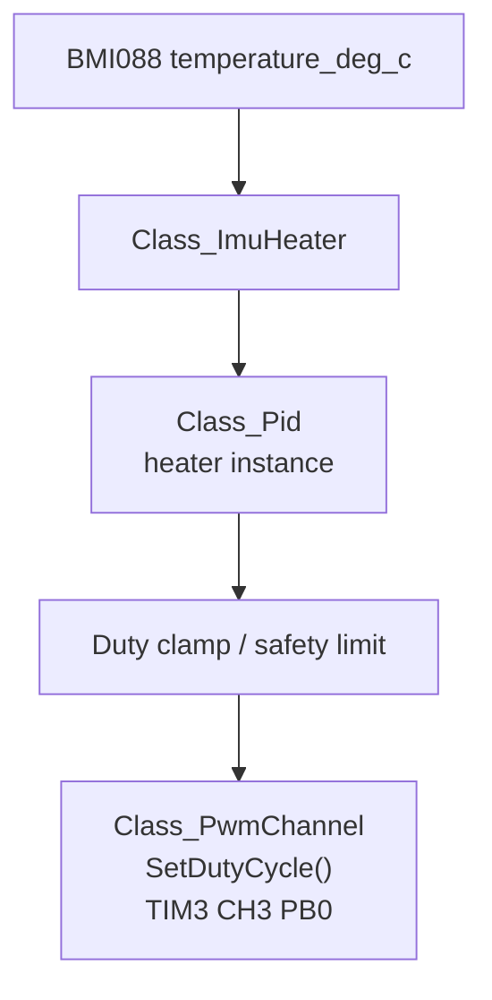

Design decisions:

- `Class_Bmi088` measures temperature; it does not own heater control.
- `Class_ImuHeater` consumes temperature and owns or references a PID instance.
- Heater target temperature, update rate, output limit, warmup criteria, and failure policy are config/policy, not sensor-driver code.
- Heater may be used to report readiness but should not necessarily be a top-level flight mode by itself.

## 18. Flight State Machine

Minimal top-level state machine:

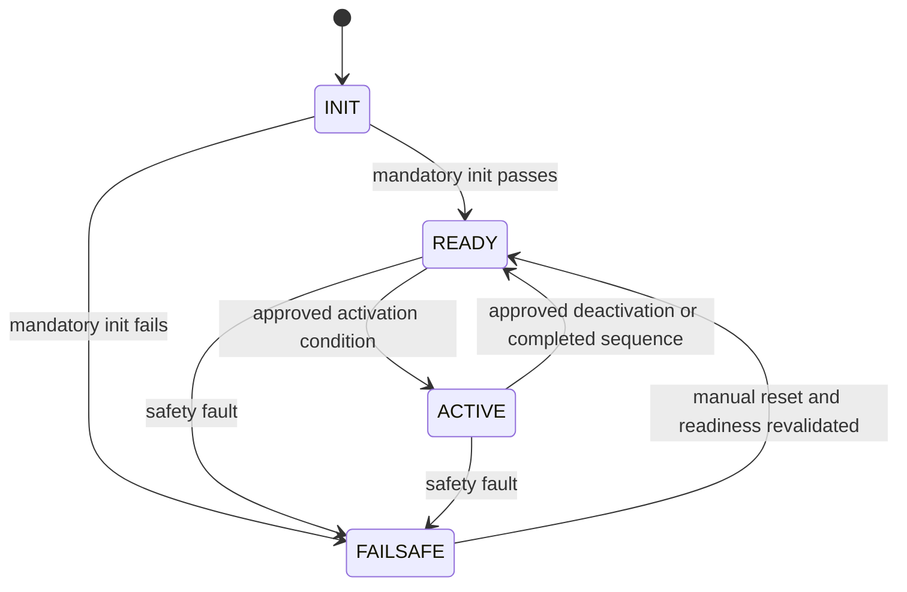

Top-level modes:

| Mode | Meaning | Servo output |
|---|---|---|
| `INIT` | HAL/User objects initializing, sensors not trusted | neutral only |
| `READY` | mandatory systems initialized, waiting for active control condition | neutral only unless approved pre-arm test |
| `ACTIVE` | flight-control output allowed | FlightController -> XTailMixer -> Servo |
| `FAILSAFE` | safety mechanism has rejected normal control | neutral by initial policy |

Device readiness is not the same as flight state. `WARMUP` and `CALIBRATION` should initially be modeled as BMI088/heater/estimator readiness statuses, not top-level flight modes. If later flight operations need dedicated behavior during warmup/calibration, they can be promoted.

When are servos allowed to accept FlightController output?

- Only in `ACTIVE`.
- `SystemStatus.imu_ready`, `host_alive` if the formal protocol later requires it, `servo_ready`, valid controller data, `fault_flags == 0`, and no task overrun condition must all be true.

When must servos hold neutral?

- `INIT`, `READY`, `FAILSAFE`.
- Any invalid command, stale IMU, stale host command, NaN/Inf, controller invalid, or mode not `ACTIVE`.

## 19. Safety/Failsafe Architecture

Separate safety mechanism from safety policy:

- Mechanism detects faults and publishes a structured safety status.
- Policy decides the actuator behavior for a specific flight phase.

Initial safe output principle:

```text
Servo Neutral = 1500 us + per-servo trim
```

Fault classes to monitor:

| Fault | Detection mechanism | Initial policy |
|---|---|---|
| BMI088 init fail | `Class_Bmi088::Init()` result | stay/initiate `FAILSAFE`, neutral |
| IMU data stale | timestamp age vs configured timeout | `FAILSAFE`, neutral |
| Host input timeout | age of latest protocol-defined valid host activity | `FAILSAFE` or stay `READY`, neutral; exact semantics deferred to Protocol Stage |
| Invalid host packet | parser validation result/counter | reject packet, count fault; policy configurable |
| Controller data invalid | `valid=false`, NaN/Inf check | reject control output, neutral |
| Task overrun | scheduler running flag/counter | record fault; if repeated, `FAILSAFE` |
| System not READY | status aggregation | block transition to `ACTIVE` |
| A133P communication lost | protocol-defined liveness timeout | `FAILSAFE` if host is later required in active mode |

`Class_DartSystem` should own state transitions. Individual devices report status; they should not independently command global flight mode except through a reported fault.

The safety mechanism sets and clears individual bits in `SystemStatus.fault_flags` as fault conditions become active or recover. `last_error` records the most recent diagnostic result but must never be used as the sole representation of current safety state.

## 20. C/C++ Integration Strategy

Current project is C/HAL with ARMCC5 (`MDK-ARM/A133P_Dart.uvprojx:13`), Arm Compiler 6 disabled (`:14`), and global C++ compiler use disabled (`:96`). Generated headers already include `extern "C"` guards.

Target bridge:

```text
main.c
  -> Task_Init()
  -> while(1) { Task_Loop(); }

HAL callbacks / IRQ C files
  -> Task_OnTim5ElapsedIsr()
  -> Task_OnImuDataReadyIsr()
  -> Task_OnUartRxEventIsr()

Task bridge
  -> translation-unit-static driver wrappers
  -> single translation-unit-static Class_DartSystem business object
```

Stage 2 first step:

1. Add the smallest possible C++ file and C-callable bridge.
2. Prove Keil/EIDE can compile/link `.cpp`.
3. Prove `main.c` can call `Task_Init()` and `Task_Loop()`.
4. Keep all C++ code hardware-inactive at first.

Global/static rules:

- Avoid using hardware from constructors.
- Constructors may only set plain default values.
- HAL handle binding and dependency injection happen in `Task_Init()` after all MX init calls.
- Static object lifetime is acceptable; dynamic allocation is not required.
- Driver wrappers and pending ISR state remain private to `task_bridge.cpp`; they are not exported through `extern` globals and are not `Class_DartSystem` value members.
- C bridge headers must be valid from both C and C++:

```cpp
#ifdef __cplusplus
extern "C" {
#endif

void Task_Init(void);
void Task_Loop(void);

#ifdef __cplusplus
}
#endif
```

This is interface guidance only; no Stage 1.1 source file is created.

## 21. Coordinate Convention

The following body coordinate convention is the architecture baseline:

```text
X forward, Y right, Z down, right-handed
```

Body axes:

| Axis | Positive direction |
|---|---|
| Body X | dart nose direction, from tail to nose |
| Body Y | right wing/right side when looking from tail to nose |
| Body Z | down, completing a right-handed aircraft body frame |

Rotations:

| Rotation | Positive direction |
|---|---|
| Roll | right-hand rotation around +X |
| Pitch | right-hand rotation around +Y |
| Yaw | right-hand rotation around +Z |

Servo numbering viewpoint:

- View from dart tail toward dart nose.
- Servo1 = Right Upper.
- Servo2 = Left Upper.
- Servo3 = Left Lower.
- Servo4 = Right Lower.

Positive surface deflection:

| Surface | Recommended positive deflection | Status |
|---|---|---|
| Servo1 Right Upper | increases `d1` in mixer equation | requires physical direction test |
| Servo2 Left Upper | increases `d2` in mixer equation | requires physical direction test |
| Servo3 Left Lower | increases `d3` in mixer equation | requires physical direction test |
| Servo4 Right Lower | increases `d4` in mixer equation | requires physical direction test |

Because actual hinge direction, horn geometry, and servo reverse can invert signs, the first implementation must route physical reversal through `ServoConfig`, not change FlightController logic.

The body convention itself is locked. The actual BMI088 accelerometer/gyroscope sensor-frame-to-body-frame axis permutation and signs still require confirmation on the assembled hardware; that transform belongs in explicit board/sensor configuration and must be validated before estimator or flight use.

## 22. Configuration Strategy

Do not put all settings into one giant `config.h`. Split by reason for change.

| Config file | Category | Examples |
|---|---|---|
| `board_hardware_config.h` | hardware config | TIM channel IDs, SPI/UART handle bindings, CS pin identity, DRDY pin identity |
| `servo_config.h` | calibration and actuator config | logical-to-physical mapping, reverse, trim, physical pulse limits, flight deflection limits |
| `control_config.h` | controller tuning | PID gains, controller output limits, rate targets |
| `safety_config.h` | safety timing/policy constants | IMU stale timeout, host timeout, overrun thresholds, active-mode prerequisites |
| `protocol_config.h` | protocol config | max frame length, buffer size, timeout constants, parser mode |
| `heater_config.h` | heater config | target temperature, duty limit, update divider |

Compile-time board configuration should be `constexpr`/`const` data. Algorithm tunables may later move to a parameter storage system, but Stage 2 should keep them static and explicit.

## 23. Error Handling

Error handling should be explicit and cheap:

- Functions that can fail return `ResultCode`.
- Runtime data structures carry `valid` flags and timestamps.
- `Class_DartSystem` collects subsystem status and owns mode transitions.
- Drivers should report HAL failures without deciding flight policy.
- Algorithms should reject NaN/Inf and invalid input instead of silently producing actuator commands.
- Fatal init errors keep the system out of `ACTIVE`.

Recommended error propagation:

```text
Driver error
  -> Device status
  -> set/clear SystemStatus.fault_flags for active conditions
  -> update SystemStatus.last_error for the latest diagnostic
  -> Safety mechanism
  -> FlightMode transition/policy
  -> Servo neutral if normal control is not allowed
```

## 24. Testability / Bring-up Strategy

The architecture should make these future tests straightforward:

| Bring-up step | Required architecture support |
|---|---|
| C++ bring-up | tiny `Task_Init/Task_Loop` bridge, no hardware use in constructors |
| TIM5 1 kHz tick verification | `Class_Timebase`/scheduler counter visible to debug/telemetry |
| Generic PWM output | `Class_PwmChannel::SetCompareTicks()` and `SetDutyCycle()` work without servo assumptions |
| Servo neutral output | `Class_Servo::SetNeutral()` converts its configured pulse width and uses the generic PWM channel |
| Single servo pulse sweep | one logical servo can be isolated by config/test command |
| Logical Servo1-4 mapping test | logical-to-physical map is table-driven |
| Reverse/trim test | reverse and trim live in `ServoConfig` |
| BMI088 chip ID | `Class_Bmi088` exposes small bring-up read path |
| BMI088 raw data | `ImuData` path exists before estimator is trusted |
| PA4 DRDY event | ISR pending flag/counter and millisecond timestamp visible to Task/Application |
| Heater PWM | `Class_ImuHeater` can be tested separately from BMI088 sensor logic |
| UART raw frame | UART driver can expose byte spans before parser is finalized |
| Host parser | parser can be unit-tested without HAL |
| XTailMixer unit test | mixer has no HAL/device dependency |
| Controller output test | controller emits `BodyControlCommand` in radians from pure data structures |
| Active fault test | multiple simultaneous `fault_flags` can be represented and cleared independently while `last_error` remains diagnostic history |

## 25. Decisions Locked in Stage 1.1

| Decision | Locked result |
|---|---|
| Primary user-code layout | `User/Config`, `User/Common`, `User/Driver`, `User/Device`, `User/Algorithm`, `User/Application`, `User/Task` |
| CubeMX ownership | `Core/` remains CubeMX/HAL-generated boundary |
| HAL boundary | HAL is wrapped in `User/Driver`; algorithms and application do not call HAL directly |
| Device/Algorithm dependency | Device may use pure general Algorithm primitives such as PID/filter, but never FlightController, XTailMixer, or other business algorithms |
| PWM abstraction | `Class_PwmChannel` is generic (`Start`, `Stop`, compare ticks, duty cycle); servo pulse-width semantics remain in `Class_Servo` |
| First-version timebase | TIM5 provides 1 kHz time; Stage 2 uses `uint32_t timestamp_ms` and `NowMs()` |
| BMI088 vs heater | sensor driver and heater controller are separate devices |
| FlightController vs XTailMixer vs Servo | three separate responsibilities |
| Internal control units | body equivalent and logical surface deflection are radians; angular rate is rad/s and accelerometer specific force is m/s^2 |
| Logical servo identity | Servo1-4 are logical surfaces, not fixed TIM1 channels |
| Logical servo numbering | Servo1 Right Upper, Servo2 Left Upper, Servo3 Left Lower, Servo4 Right Lower |
| Physical servo mapping | all logical Servo-to-TIM-channel mapping remains in Config |
| ISR policy | ISR only updates pending flags/counters, millisecond timestamps, small metadata, and required HAL handlers |
| First-version event transport | TIM5/BMI088/UART use simple pending flags/counters; no EventQueue in Stage 2 first version |
| Scheduler base | TIM5 is designed as 1 kHz heartbeat |
| Composition root | `task_bridge.cpp` privately owns driver wrappers and the one top-level `Class_DartSystem`; the system owns devices, algorithms, and state |
| Active fault state | `SystemStatus.fault_flags` represents simultaneous current faults; `last_error` remains recent diagnostic history |
| Body coordinate convention | X forward, Y right, Z down, right-handed |
| Safe default output | neutral servo output before active control and during initial failsafe policy |
| C++ strategy | static objects, C bridge, no dynamic allocation dependency, no exceptions/RTTI intended |

## 26. Decisions Explicitly Deferred

| Deferred decision | Reason |
|---|---|
| Final PID gains | Requires simulation/bench/flight tuning |
| Final controller frequency | Depends on sensor ODR, controller design, CPU budget |
| Final flight surface max angle | Requires mechanical and flight validation |
| Final attitude estimator | Mahony/EKF/complementary/etc. not selected in Stage 1.1 |
| Final A133P frame format | Protocol design deferred |
| CRC type | Protocol design deferred |
| A133P command types and payload | `Arm`, `Disarm`, `Guidance`, `Heartbeat`, and all semantic payload fields/units await the formal Protocol Stage |
| BMI088 final ODR/filter | Sensor bring-up and noise evaluation required |
| BMI088 DRDY vs polling final mode | Architecture supports both; implementation choice deferred |
| BMI088 sensor-to-body transform | Body convention is locked, but actual sensor axis permutation/signs require assembled-hardware confirmation |
| Heater target temperature | Requires thermal/mechanical validation |
| Final failsafe flight behavior | Neutral is initial safe default; real flight behavior needs validation |
| XTail matrix final signs | Must be verified with real servo direction and airframe geometry |
| Microsecond timebase | Add DWT or another high-resolution timer only when a real microsecond-resolution requirement is established |
| EventQueue | Add only when ordered multi-event preservation is required; first Stage 2 version uses pending flags/counters |
| TIM1 333 Hz CubeMX change | Current config is 50 Hz; hardware-config stage should modify if approved |

## 27. Stage 2 Recommended Scope

Stage 2 should build a compiling skeleton from bottom to top, not a complete flight controller.

Recommended breakdown:

| Stage | Goal | Output |
|---|---|---|
| 2.0 | C++ toolchain bring-up | `Task_Init/Task_Loop` bridge compiles and links from `main.c` |
| 2.1 | Common + Config skeleton | explicit-unit data structs/enums and static config tables compile; A133P semantic command payload remains absent |
| 2.2 | Driver skeleton | SPI/UART/generic PWM/GPIO/`NowMs()` wrapper interfaces compile with HAL handles |
| 2.3 | Device skeleton | BMI088, ImuHeater, Servo, and transport-only HostCommunication objects exist with safe no-op behavior |
| 2.4 | Algorithm interfaces | PID/estimator/controller/mixer interfaces compile, minimal deterministic outputs |
| 2.5 | Application/Task integration | Task composition root owns driver wrappers and pending flags/counters; `Class_DartSystem` owns devices/algorithms/state and receives injected dependencies |
| 2.6 | Full framework compile | complete object graph builds, servos default neutral, no real flight algorithm required |

Stage 2 should still defer detailed BMI088 driver behavior, formal UART/A133P command protocol, microsecond timebase, EventQueue, final attitude estimation, flight PID tuning, and validated X-tail signs to later stages unless specifically approved.
